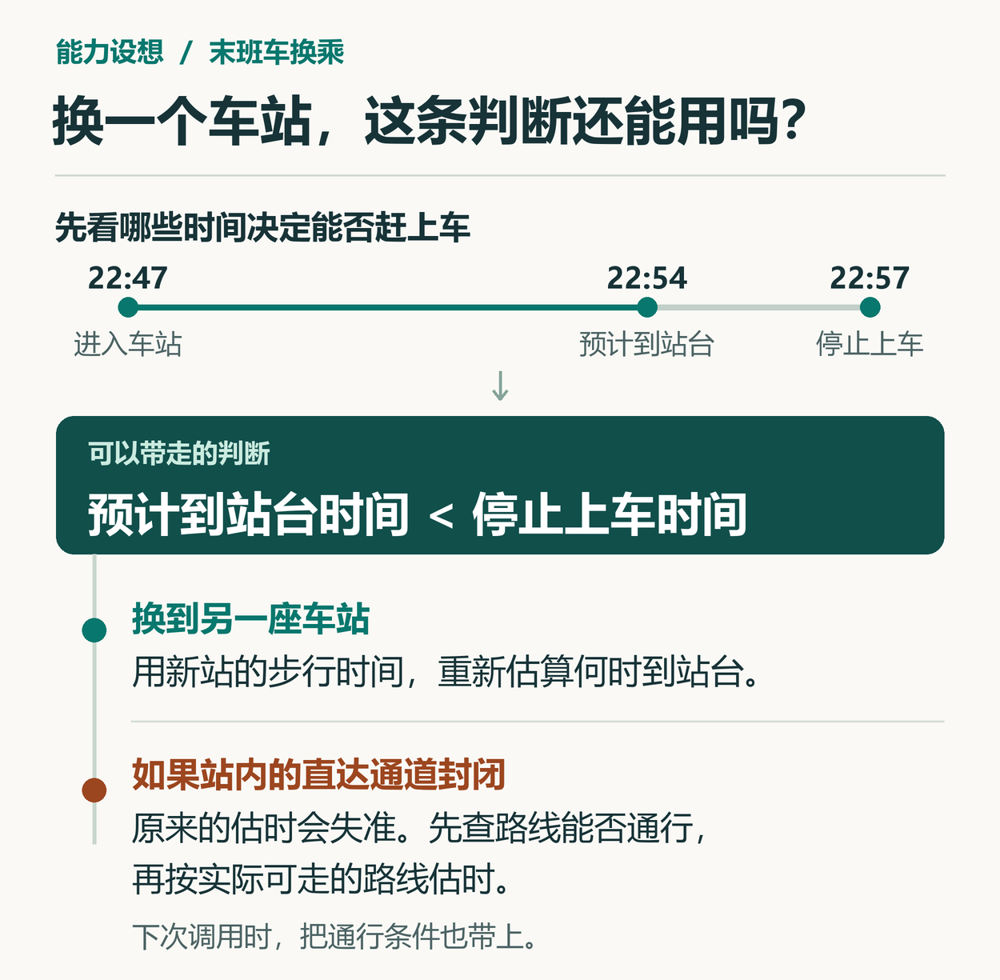

# Attention 的下一个十年，会是 Intuition 吗？

想象你刚跳下地铁，抬头一看，末班车还有四分钟。手机里的 AI 知道列车时刻，读过车站平面图，甚至能告诉你这座站是哪年建的。你现在最想听它说哪一句？

我希望它先问：“下一班就在对面，还是得上楼换站台？”

同样四分钟，一种情况够你慢慢走过去，另一种情况可能只够你跑到一半。熟悉这座站的人先看站台，中间省掉了不少推理。**我期待下一代模型学会的，就是这第一眼该看哪里。** 更要紧的是，谁教它看这一眼？如果每条经验都得由产品经理写进提示词，我们究竟是在训练一位行家，还是在替它编一本永远写不完的手册？

## 模型自己长出来的那一栏

2017 年，《Attention Is All You Need》提出了 Transformer。注意力机制允许模型在处理一个位置时，按相关程度组合其他位置的信息。顺着这个思路，我想往下追半步：如果眼前最有用的那个量，压根没写在任何一行里呢？[Attention 原文](https://arxiv.org/abs/1706.03762)

回到站台。时刻表有“发车时间”，地图有“步行耗时”，乘客还知道自己拖着两只箱子。可真正让人决定跑不跑的，往往是**走到车门前还富余几分钟**。谁也没递给你这么一栏，是你临时把它想了出来。一旦有了它，问题就变了。你会去问电梯在哪边，或者拦住一个站务员问几点关门。车站的建成年份再准确，也帮不上这一趟忙。

我愿意把这种能力叫作 *Intuition*。这里的“直觉”有个很朴素的意思：吃过几次亏之后，你会换一种方式看问题。对模型来说，同一段经验可以留下两个截然不同的东西。它可以记住“上星期五我在南站没赶上车”，也可以学会下次碰到换乘先估一下到车门的余量。前一句值得在你问起上周五时翻出来。后一个判断，却有机会在你第一次去北站时救你一趟。

## 一套模型，用半年，能不能用出两个行家？

我愿意押一个比“下一代会更聪明”具体得多的判断。**把同一个出厂模型交给两个人，一个天天调度晚班列车，一个天天给旅客安排无障碍换乘。半年后，面对同一张站图，它们最先追问的事情应该已经不同。** 前者可能先查末班车能等多久，后者会先查对面那部电梯今晚开不开。两边的答案都找得到依据。真正拉开差距的，是谁能用最少的追问，先碰到那个足以改变决定的事实。

这在技术上有迹可循。DreamCoder 会从解过的题中提炼可以组合的程序部件，用它们表达以后的解法。Voyager 在《我的世界》里把学到的行为存成可执行代码，到了新世界还可以取用。一个让系统逐渐拥有更好用的表达方式，一个让成功的操作活过了上一次任务。它们给了我押这个方向的理由。[DreamCoder](https://arxiv.org/abs/2006.08381) · [Voyager](https://arxiv.org/abs/2305.16291)

下一步最难的，我猜是让模型**自己发现缺了哪一个概念**。假设送给它一万条赶车记录，它可能总结出“周五容易误车”。可要是恰好周五跨站台的乘客多呢？找出两个同样要换站台的周五，一个赶上，一个没赶上，差在了哪里？我希望模型会拿几种解释互相较劲，把经得住换站、换日子的一种记下来。下回听到“就剩四分钟”，哪怕这座站从没出现在那一万条记录里，它也知道该先问站台。要是乘客已经说了“车就在对面，车门开着”，它也该知道省掉这句废话。

这也改变了我对训练的想象。一次回答值几分，可以当场判。一个新概念值几分，可能要等后面十道题。它有没有替模型少问两句废话？有没有让模型在信息不足时收住一句过分自信的“来得及”？如果后续表现能反过来影响模型保留哪些概念，**“以后用得上”就有机会变成训练目标。** Attention 仍然可以负责眼前各条信息怎样配合，经验里长出的概念则能改变下一次有哪些量值得算、哪些信息值得找。

## 六段路，验了这个想法的哪一步？

我们做过一个极小的检验。给一个 Python 程序六组距离和时间，没给“速度”这个类型，也没给速度公式。我们告诉它，以后还要算路程。它可以用四则运算拼短算式，把算出相同值的观察归为一组，再看每组留下的数能否配合时间还原距离。在最多五个节点的 274 个候选表示中，它选出了“距离除以时间”，也找到了配套的乘法。

有意思的是，“每米要花几秒”也在训练集上并列入围。去跑步的人管它叫配速。两种写法都能解释六条记录，可一旦允许人原地站一秒，配速就碰上了除以零。哪些情形也应当算数，光靠这六条记录定不下来。

2 秒走 5 米和 8 秒走 20 米，就这样成了同一个速度对象。两趟路差了整整 15 米，这个差别确实被丢掉了。要问谁走得远，光靠对象已经答不出来。要问照这个快慢再走 7 秒有多远，两趟却可以互换。这个新对象保留了什么，取决于我们还想拿它做什么。

我们冻结对象和规则，验证后删掉了本次运行的训练、验证输入文件，把注册表和任务单交给新进程。它独立算出了 14、21、25 米。前两项是新预测，25 米在验证时算过，算一次复算。完整流程重复三次，结果一致。这里实际跑通的只有一件事：在人的搜索范围和任务约束下，**经验可以留下一个能被别的程序调用的数学对象**。至于一个大模型能否自己察觉该造什么对象，在陌生任务中挑对它，这笔账还没结。[实验记录与代码](experiment/README.md) · [验证记录](experiment/runs/run_01/audit/validation.json) · [独立计算结果](experiment/runs/run_01/runtime/result.json)

## 糟糕的直觉，比没有直觉更贵

设想那个 AI 学会了换乘余量，连着十次判断正确。第十一次，老站改造，原先横穿站厅的通道封了。模型凭经验答得又快又肯定。旅客跑到围挡前，才知道这一分钟省在了谁身上。

这恰好是我对“模型越用越懂你”最大的保留。错一次的临时推理，伤的是一回。一个被保存下来、天天调用的坏判断，反而会越用越熟练。**下一代模型若能积累直觉，就得同样擅长撤回直觉。** 在这个例子里，我希望它还能指出，出错的是“穿过站厅只要两分钟”这条旧经验。通道临时关闭，它就把这条经验停用，重新算路。整座城市的时刻表毋须陪它重新学一遍。

我甚至觉得，这会改变人们挑 AI 的方式。一个模型如果总能说出上次为什么判错、哪条经验已经停用、下一次遇到什么情况会再问人，我愿意把更长的项目交给它。因为交接时，我能带走一份经得起盘问的本事，也知道哪里还埋着坑。这样的经验究竟留在模型参数里，还是先放进一套能检查、能修改的外部规则里，是可以让工程师争个痛快的实现问题。对使用它的人，两件事更切身：谁能改掉一条坏经验，改完之后它明天还会不会再犯？

## 我会怎样给这场赌判输赢

如果只给下一代模型出一张陌生考卷，阅卷人永远看不到它怎样积累经验。我想让评测持续一个月。两套系统用相同的基础模型，看同样多的历史记录，可以翻同样的资料。一套另外可以提出、检验、复用自己的判断。题目提前封好，中途故意改一次规则。把造工具、查资料和返工的开销全算进去。

我想看三个时刻。头一天，允许它为一个好判断多花点工夫。第十天，在没见过的新站，它能不能用同样的准确率、更少的计算做出决定？第二十天，熟悉的通道突然封闭，它究竟要错几回才会改口？改完，再悄悄塞进一道别的车站的旧题，看它修好一处有没有顺手改坏另一处。如果省下的工夫一直抵不过建立和修理这些判断的代价，那么在这批任务上，我就输。多写一万条能调用的规则，也不能替我翻盘。

Attention 的下一个十年，我押 Intuition。这一票投给的是一种很具体的进步：昨天的经历，能让模型今天更早问到要害，也能让它在经验失效时及时改口。哪天我站在一个完全陌生的站台，手机屏幕上只剩四分钟，我会用一个很小的细节来判断那十年走到了哪里。它开口的第一句，是报出我已经看得见的倒计时，还是问我——**“你看得见对面那扇车门吗？”**

## 一起建设

你见过 AI 把昨天管用的经验用错地方吗？当时它要是多问你一句，问什么能改变结果？欢迎把那次对话讲给大家听。[去讨论区聊聊](https://github.com/yeqiu1121/attention-to-intuition/discussions)

发现文章说错了、实验跑出了不同结果，或者想亲手改一处？可以[提出问题](https://github.com/yeqiu1121/attention-to-intuition/issues/new)，也可以照着[中文共建指南](CONTRIBUTING.md)提交修改。
